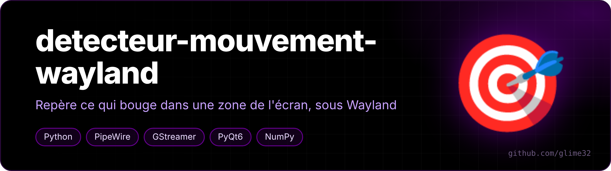

<p align="center"></p>

<p align="center">   </p>

<p align="center"><a href="README.md">🇬🇧 English version</a></p>

Surveille une zone de l'écran et entoure en rouge ce qui bouge dedans, en direct, sous KDE Plasma 6 / Wayland.

C'est surtout un exercice pour apprendre à capturer l'écran proprement sous Wayland en Python, en faisant attention à la batterie. Les outils classiques (`mss`, `pyautogui`...) ne marchent que sous X11 : sous Wayland ils ne voient qu'une image noire.

## Fonctionnement

- **Capture** : portail XDG `ScreenCast` + flux PipeWire lu avec GStreamer. KDE demande quel écran partager au premier lancement, puis le choix est retenu (`restore_token`).
- **Détection** : différence entre deux images, sur une version réduite de la zone (~160 px de large, canal vert seulement), découpée en cases de 8 px. Les cases voisines qui bougent sont regroupées en rectangles.
- **Affichage** : une fenêtre PyQt6 transparente plein écran, au-dessus de tout, que les clics traversent. Cadre violet autour de la zone, rectangles rouges sur le mouvement.
- **Raccourci global** Meta+Alt+Z via le portail `GlobalShortcuts`, icône dans la zone de notification (clic = nouvelle zone, clic droit = pause / quitter).

## Économie de batterie

- KWin n'envoie une image que quand l'écran change, max 8 par seconde : écran figé = script qui dort ;
- curseur exclu de la capture ;
- aucune minuterie qui tourne en boucle ;
- en pause, le flux est coupé côté KWin ;
- les rectangles dessinés par l'overlay sont masqués de l'analyse, sinon il se détecterait lui-même.

## Installation

Avec le Python du système (pas un venv, sinon `gi` est introuvable) :

```bash
sudo pacman -S --needed python-pyqt6 python-numpy python-gobject \
    gst-plugins-base gst-plugins-good gst-plugin-pipewire xdg-desktop-portal-kde
python detecteur.py
```

Ensuite : l'écran s'assombrit, on trace la zone à la souris (Échap pour annuler). `python detecteur.py --zone` depuis un autre terminal pour en tracer une nouvelle. Ctrl+C pour quitter.

Réglages (`FPS_MAX`, `SEUIL_PIXEL`, `SEUIL_CASE`...) en haut du fichier.

## Limite

KWin envoie une image dès que quelque chose change n'importe où sur l'écran, pas seulement dans la zone. Une vidéo ailleurs réveille donc le script jusqu'à 8 fois par seconde (ça reste léger). Baisser `FPS_MAX` si besoin.
