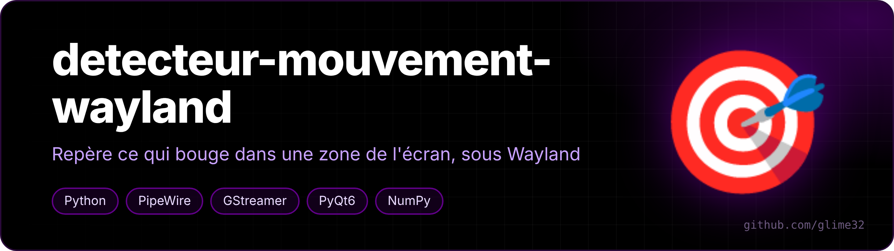
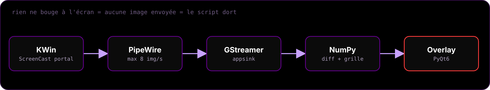

<p align="center"></p>

<p align="center">   </p>

<p align="center"><a href="README.fr.md">🇫🇷 Version française</a></p>

**Watches an area of your screen and outlines whatever moves inside it, live — on Wayland.**

Mostly an exercise in capturing the screen *properly* under Wayland from Python, while keeping battery use minimal. Classic tools (`mss`, `pyautogui`…) only work on X11; on Wayland they just see a black image.

<p align="center"></p>

## How it works

- **Capture**: XDG `ScreenCast` portal + PipeWire stream read with GStreamer. KDE asks which screen to share the first time, then remembers it (`restore_token`).
- **Detection**: difference between two frames on a downscaled copy of the area (~160 px wide, green channel only), split into 8 px cells; neighbouring moving cells are merged into rectangles.
- **Overlay**: a transparent, always-on-top, click-through PyQt6 window. Purple frame around the area, red boxes on motion.
- **Global shortcut** Meta+Alt+Z via the `GlobalShortcuts` portal, plus a tray icon (click = new area, right-click = pause / quit).

## Battery

- KWin only sends a frame when the screen changes, max 8/s — a still screen means the script sleeps;
- cursor excluded from capture; no polling timers; stream paused on KWin's side when you pause;
- the overlay's own rectangles are masked out of the analysis.

## Run

```bash
sudo pacman -S --needed python-pyqt6 python-numpy python-gobject \
    gst-plugins-base gst-plugins-good gst-plugin-pipewire xdg-desktop-portal-kde
python detecteur.py            # draw the area with the mouse, Esc to cancel
python detecteur.py --zone     # pick a new area from another terminal
```

Use the system Python (not a venv), otherwise `gi` isn't found.
